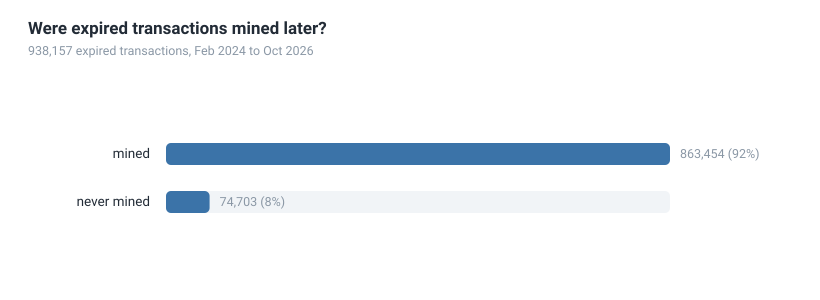
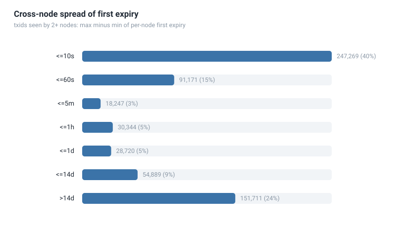

# Expired mempool transaction fate

Data: `expiry.log.zst`, a `reason=expiry`-only extract from b10c's 15-node fleet. Window 2024-02-16 to 2026-10-21:
12,650,774 events, 938,157 unique txids. Method: block scan of an unpruned node, txid intersection,
verified with `getrawtransaction`. Method spec: [EXPIRY_SCAN_SPEC.md](../EXPIRY_SCAN_SPEC.md).

| metric | value |
| --- | --- |
| confirmed | 863,454 (92.0%) |
| never confirmed | 74,703 (8.0%) |
| rebroadcast (lower bound) | 316,381 (33.7%), 86.9% of them confirmed |
| mined before first expiry (lagging-node eviction) | 252,571 (29% of confirmed) |
| confirm delay, mined after expiry | p50 10.8d, p90 80.5d, max 317d |
| cross-node spread (2+ nodes) | p50 27s, 54% within 60s, 24% over 14d |
| confirm rate, 1 node vs many | 98.0% vs 89.0% |

## Surges or a constant stream
Expiries are a low baseline with occasional big spikes. The median day has about 101
transactions expire; the mean is ~1513 per day. The top 10 days are 31% of all
expiries and the top 30 days 57%. Volume does not change the mined rate: 91.8% on
the top 30 surge days vs 92.3% on all other days.

## What kind of transactions expire
From a sample of the mined expired txs, read from their raw transaction: about 47% regular payments,
40% runes, 11% ordinal inscriptions, 2% other data. The surges are almost all runes: the biggest surge
days are 99 to 100% Runestone transactions. Only mined txs can be typed, since reading a raw tx needs
the block and there is no txindex.

## Limitations
- Rebroadcast is a lower bound; the true rate needs the `AddedToMempool` stream.
- Replaced-vs-lost is not separable: an expired transaction is already evicted, so it is never logged
  as replaced; splitting it would need the expired transactions' inputs, which the logs do not carry.
- About 29% of confirmed txids were mined *before* their first expiry: a single lagging node expired a
  tx that was already on-chain. They are reported separately; the "mined after expiry" delay excludes
  them.
- Coverage is not continuous: ~37% of calendar days in the window have no events in the extract
  (collection gaps, including a ~130-day gap in mid-2025), which limits temporal/continuity analysis.
- The extract was also built without `grep -a`, dropping ~12 days.

Text summary: [summary.txt](summary.txt). The full per-transaction CSV is produced by `report`
locally and is not committed (about 170 MB).
