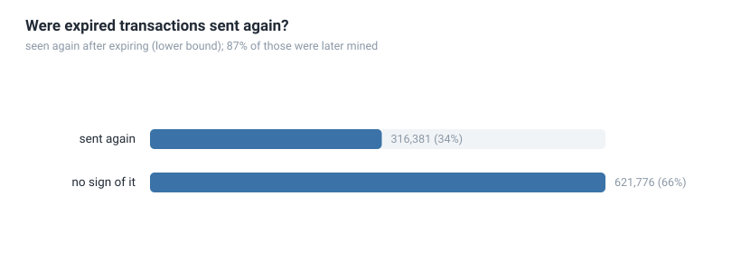
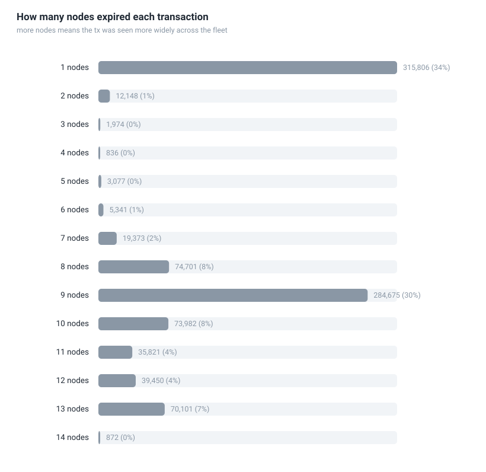

# Expired mempool transaction fate

Data: `expiry.log.zst`, a `reason=expiry`-only extract from b10c's 15-node fleet. Window 2024-02-16 to 2026-10-21:
12,336,976 events, 685,586 unique genuine-expiry txids. (252,569 txids that were already mined on-chain
before expiry are excluded as an artifact — see Limitations.) Method: block scan of an unpruned node,
txid intersection, verified with `getrawtransaction`. Method spec: [EXPIRY_SCAN_SPEC.md](../EXPIRY_SCAN_SPEC.md).

| metric | value |
| --- | --- |
| confirmed | 610,883 (89.1%) |
| never confirmed | 74,703 (10.9%) |
| rebroadcast (lower bound) | 255,314 (37.2%), 83.7% of them confirmed |
| confirm delay | p50 10.8d, p90 80.5d, max 317d |
| cross-node spread (2+ nodes) | p50 27s, 54% within 60s, 24% over 14d |
| confirm rate, 1 node vs many | 90.2% vs 89.0% |

## Limitations
- Rebroadcast is a lower bound; the true rate needs the `AddedToMempool` stream.
- Replaced-vs-lost is not separable: an expired transaction is already evicted, so it is never logged
  as replaced; splitting it would need the expired transactions' inputs, which the logs do not carry.
- 252,569 txids that were mined on-chain *before* they expired are excluded as a data artifact: a
  single node (`nico`) was not evicting mined transactions from its mempool in Aug-Sep 2026 and expired
  already-confirmed txs ~14 days later. Flagged to b10c. All figures here are the genuine-expiry set.
- Coverage is not continuous: ~37% of calendar days in the window have no events in the extract
  (collection gaps, including a ~130-day gap in mid-2025), which limits temporal/continuity analysis.
- The extract was also built without `grep -a`, dropping ~12 days.

Text summary: [summary.txt](summary.txt). The full per-transaction CSV is produced by `report`
locally and is not committed (about 170 MB).
